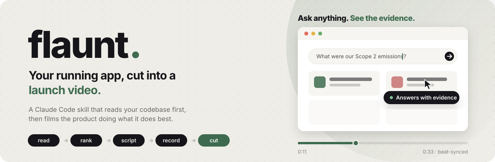
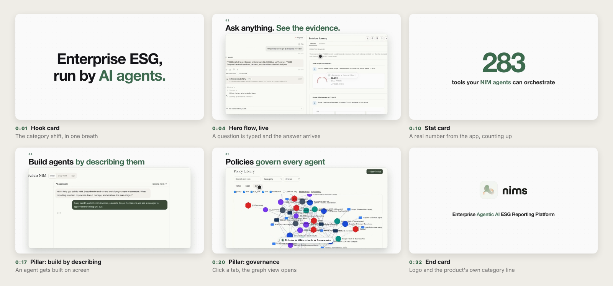
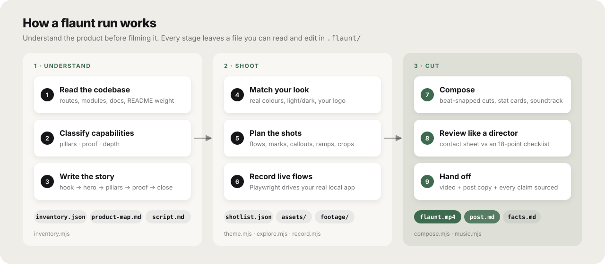
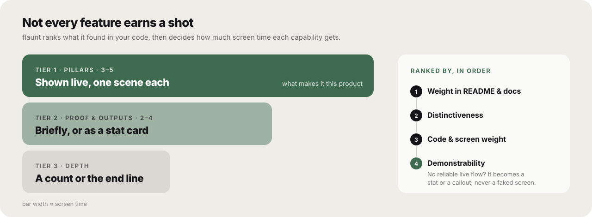
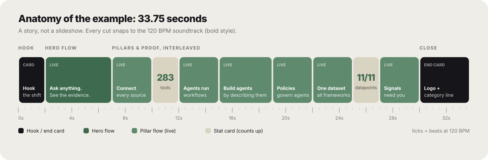
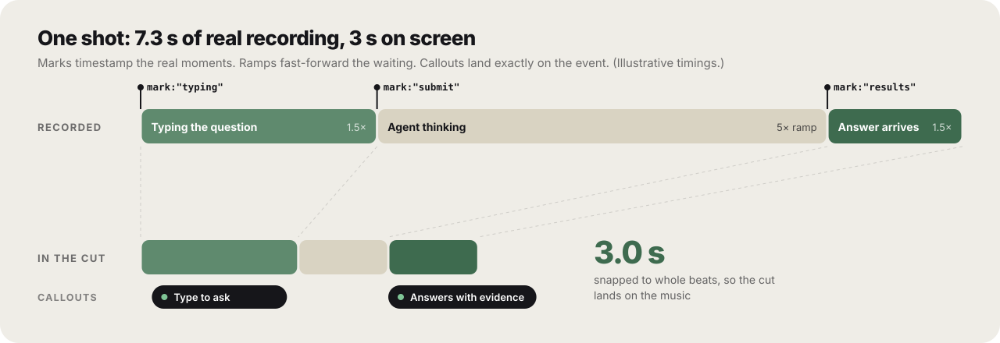

<p align="center">
  
</p>

<p align="center">
  <a href="#install">Install</a> ·
  <a href="#use">Use</a> ·
  <a href="#how-it-works">How it works</a> ·
  <a href="#what-makes-it-feel-alive">Live flows</a> ·
  <a href="#safety">Safety</a>
</p>

<p align="center">
  
  
  
  
</p>

---

**flaunt** is a [Claude Code](https://claude.com/claude-code) skill that turns a running app into a launch video.

Most launch-video tools film screens. **flaunt understands the product first.** It reads your codebase, works out
what the product is, ranks its capabilities by importance, writes a story, then drives your real app through
**live flows** (typing, answers arriving, tabs opening, agents being built) and cuts a 25-40 second, beat-synced
video in your product's own theme, ending on your logo and category line. Post copy included.

## See it

<p align="center">
  <a href="examples/launch-video-example.mp4">
    
  </a>
  <br>
  <sub>▶ <a href="examples/launch-video-example.mp4">Full-quality MP4 with sound (33 s)</a></sub>
</p>

Generated by running flaunt **once** on an open-source reporting platform, with the app in a deterministic demo mode:
a hook, live flows with callouts, stat cards, and a logo end card. Nothing in it was edited by hand.

<p align="center">
  
</p>

## Screen recorder vs. flaunt

| | A screen recording | flaunt |
|---|---|---|
| **Starts from** | Whatever screens look nice | Your codebase, README and docs |
| **Decides what to show** | You do | Ranks capabilities into pillars, proof and depth |
| **Structure** | A sequence of screens | A script: hook → hero flow → pillars → proof → close |
| **Motion** | Scrolling and hovering | Live state changes: type → answer, click → new view |
| **Pacing** | Real time, including loading | 1.5× footage, ramps over waits, cuts snapped to the beat |
| **Look** | Generic template | Your app's sampled colours, light/dark mode and logo |
| **Claims** | Whatever the caption says | Every claim traced to footage or docs in `facts.md` |
| **Sound** | Stock track or none | Synthesized soundtrack, no licences needed |

## Install

```
/plugin marketplace add SaquibPM/flaunt
/plugin install flaunt@flaunt
```

Requirements: Node.js 20+, FFmpeg with the `xfade`, `zoompan` and `alimiter` filters (`brew install ffmpeg`).
On first use `scripts/doctor.sh` installs Playwright and Chromium next to the scripts.

## Use

Start your app locally, then in the project folder:

```
/flaunt
/flaunt --style techy --shape tall --since v1.4.0
```

You can also just ask: *"flaunt this"*, *"make a launch video of this app"*, *"announce this release on video"*.

| Flag | Meaning | Default |
|------|---------|---------|
| `--style` | `bold`, `calm`, `techy`, `warm` | `bold` |
| `--shape` | `wide` 16:9, `tall` 9:16, `square` 1:1 | `wide` |
| `--length` | Target length, 23-40 s | what the story needs |
| `--tagline` | Category line on the end card | derived; confirmed with you |
| `--since <ref>` | Feature what changed since a tag/commit/date | off |
| `--url <url>` | Use an already-running local app | off |
| `--link <text>` | URL/command on the end card | none |
| `--silent` | No soundtrack | off |
| `--dir <path>` | Project folder | `.` |

### Styles

Each style sets the soundtrack's tempo, the type weight and the transition set. The look itself always comes from
your product.

| Style | Tempo | Type | Transitions | Good for |
|-------|-------|------|-------------|----------|
| `bold` | 120 BPM | Heavy, tight | Slides and wipes | Launches, big releases |
| `techy` | 112 BPM | Monospace | Directional wipes | Dev tools, APIs, CLIs |
| `warm` | 100 BPM | Bold | Smooth slides and fades | Consumer and community products |
| `calm` | 84 BPM | Semibold | Fades | Enterprise, finance, health |

## How it works

<p align="center">
  
</p>

1. **Read the codebase.** `scripts/inventory.mjs` scans routes, modules, docs and README weight and ranks capability candidates.
2. **Classify.** The agent writes `product-map.md`: pillars (shown live), proof (stats), depth (end line only).
3. **Script.** `script.md` is the story; the shotlist is derived from it.
4. **Match your look.** `scripts/theme.mjs` samples the app's real colours and light/dark mode; the logo is the last frame.
5. **Record.** `scripts/record.mjs` drives the app through live flows, marking real moments.
6. **Compose.** `scripts/compose.mjs` adds callouts anchored to those moments, speed ramps over waiting, stat cards,
   beat-snapped cuts and a synthesized soundtrack.
7. **Review.** The agent checks a contact sheet and key frames against `references/craft.md` before handing over.

### It decides what matters before it films

<p align="center">
  
</p>

A viewer should be able to say what the product is, what its 3-5 pillars are and why it is different, without
reading anything else. Pillars are ordered by dependency (inputs → intelligence → control → outputs), and the end
line is the product's **category in its own words**, not a slogan.

### It writes a story, then cuts to it

<p align="center">
  
</p>

| Beat | Length | Job |
|------|--------|-----|
| Hook card | ~2 s | One claim a stranger understands instantly |
| Live flows ×6-8 | ~3-4.5 s each | One pillar or proof each, a real interaction |
| Stat cards ×1-2 | ~2 s each | A real, verified number, counting up |
| End card | ~4 s | Your logo and category line |

Length is a hard window: **never under 23 s, never over 40 s.**

## What makes it feel alive

<p align="center">
  
</p>

- **Every flow shows a state change.** Type → result appears; click → tab opens; submit → answer arrives. At most two hover-only shots per video.
- **Marks** timestamp the real moments during recording (`"mark": "results"`).
- **Ramps** fast-forward dead time between two marks, so an agent "thinking" never drags.
- **Callouts** are pills pinned to the UI that name what is happening, timed to the mark, not to a guess.
- **Crop and push-in** drop sidebars and top bars, with a gentle 1.05-1.15 zoom so content fills the window.
- **Rehearsal** runs stateful flows once off camera first, so the recorded take is clean and repeatable.

A trimmed shot from a shotlist:

```jsonc
{
  "id": "s1",
  "caption": "Ask anything. *See the evidence.*",
  "steps": [
    { "goto": "/home" },
    { "waitFor": "#ask", "mark": "typing" },
    { "type": ["#ask", "What were our Scope 2 emissions?", 28] },
    { "press": "Enter", "mark": "submit", "retryUntilUrl": "/chat/" },
    { "waitFor": "text=Emissions Summary", "mark": "results" }
  ],
  "ramps":    [{ "from": "submit", "to": "results", "speed": 5 }],
  "callouts": [{ "text": "Answers with evidence", "after": "results", "dur": 1.2, "x": 0.7, "y": 0.45 }],
  "crop": { "x": 0.2, "y": 0.08, "w": 0.78 },
  "zoom": { "x": 0.5, "y": 0.4, "scale": 1.07 }
}
```

The full format is in [`references/shotlist-schema.md`](skills/flaunt/references/shotlist-schema.md).

## What you get

Output lands in `.flaunt/` (git-excluded locally). Every file is plain text you can read and edit, then re-run.

```
.flaunt/
├── inventory.json    machine scan of the codebase
├── product-map.md    purpose, audience, category, capabilities in tiers, with evidence
├── script.md         the story: scene by scene, what is shown, what is said, why
├── shotlist.json     the executable plan (brand, hook, live flows, stats, end card)
├── facts.md          every claim in the video tied to a file or to footage
├── assets/           your logo
├── footage/          one raw clip per flow
├── flaunt.mp4        the video
└── post.md           launch post copy, payoff first
```

Redo a single shot without re-recording the rest: `record.mjs shotlist.json --only s2,s3`.

## The quality bar

Before handing over, the agent reviews a contact sheet and full-size frames and fails its own cut if any of these
are true (the full 18-point list is in [`references/craft.md`](skills/flaunt/references/craft.md)):

- Length outside 23-40 s, or a Tier-1 pillar missing
- Fewer than two-thirds of flows show a state change
- A callout names something not visible on screen at that moment
- A spinner, empty state, error overlay or stale banner is on screen
- A login form, credential, email, token or customer data is visible
- The look doesn't match the product's theme, or the logo isn't the final frame
- A number or claim isn't in the footage or docs

> *If I only saw the first two seconds, would I keep watching?*

## Safety

- Records **local development servers only** (`localhost`, `127.0.0.1`, `*.localhost`, `*.test`); anything else is refused.
- **Never calls paid or external services while recording.** It starts the app in the project's own mock/fixture mode
  where one exists and checks env files for keys by presence only.
- Uses seed/demo accounts, signs in off camera, never types real credentials, and checks frames for sensitive data.
- Every claim on screen must be visible in the footage or the project's docs.
- Leaves the project clean: `.flaunt/` goes into `.git/info/exclude`, and anything it changed is restored.

## Status

> **Experimental.** Built and tested on macOS with two apps. `--since`, tall/square shapes, `--silent`,
> Windows and Linux are untested. Audio was checked numerically, not by ear.

Issues and pull requests with results from other apps, platforms and shapes are very welcome.

## Repository layout

```
skills/flaunt/
├── SKILL.md              the agent's playbook
├── references/           craft bar, shotlist schema, templates for map/script/facts/post
└── scripts/              doctor, inventory, theme, explore, record, compose, music, svg2png
examples/                 the example video
docs/assets/              images for this README
```

## License

MIT
